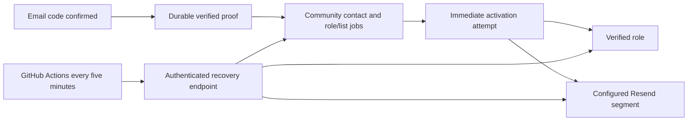

# Discord deployment and recovery

Updated 6 October 2026. This change covers the Discord bot and its durable verification jobs. Email branding is deferred. No PR, production deployment, production Discord permission changes, or existing-member migration is included.

## How recovery works

The verification request still attempts activation immediately. MongoDB holds the verified proof and desired role/list operations before external calls. If Discord, Resend, the database, or the request fails, the work survives closing the browser.

The GitHub workflow is scheduled every five minutes, offset from the start of the hour. This is best-effort recovery: GitHub can delay or drop scheduled runs, and schedules require the workflow on the default branch. It follows the repository's existing scheduler approach and avoids Vercel Hobby's daily-only cron restriction. Sources: [GitHub schedule behavior](https://docs.github.com/en/actions/reference/workflows-and-actions/events-that-trigger-workflows#schedule), [Vercel cron limits](https://vercel.com/docs/cron-jobs/usage-and-pricing).

The deployed endpoint uses the existing project's **60-second function limit**. Each worker run has a 50-second work budget, recovers up to three unfinished proofs and processes up to three due contacts. It reserves enough time before starting each provider stage: role activation may need two 10-second requests; new-contact enrollment may need four. A slow role stage can leave the list job for the next run. Deferred work remains pending without consuming retry attempts. A processed contact count means attempted contact processing, not necessarily completed activation.

A MongoDB lease prevents overlapping workers for the configured guild, role, and segment. The lease expires after 90 seconds if the process dies. Existing contact leases expire after 120 seconds; completed stages are saved separately, so retrying does not replay a saved role grant. Provider requests time out after ten seconds. Retry delays respect provider Retry-After and exponential backoff; invalid credentials/permissions need operator attention rather than an endless automatic loop. Existing unsubscribe status is preserved.

The worker state records the last start, finish, success, failure, and processed count. Health results contain job counts and generic errors, never email addresses, codes, tokens, or raw provider responses. Contacts are selected only for the configured guild, role, and segment; test/production namespaces remain separate.

## Endpoint and credentials

`GET /api/discord/process` reads health only. `POST /api/discord/process` performs recovery. Both require:

- `Authorization: Bearer <COMMUNITY_PROCESS_SECRET>`
- `x-community-environment: test` or `production`, matching the deployment
- `x-community-guild: <configured Discord server ID>`

`COMMUNITY_PROCESS_SECRET` is an independent server-side secret of at least 32 characters. The journal's `CRON_SECRET` does not authorize this endpoint. Wrong/missing authentication returns 401; a mismatched target returns 409 before any processing. The responses are not cached.

Local operator recovery remains available with `npm run community:process`, using the same lease and budget. `npm run community:check -- --live` is read-only and does not invoke recovery or send mail.

## Test deployment

Use a preview deployment of the existing `thomasjohnston` Vercel project, with no production alias or project-wide environment changes. Its runtime and build settings explicitly use:

| Setting | Test value |
| --- | --- |
| Community environment | `test` |
| Mongo database | `blueprint_dev` |
| Discord server | `1556786037307613317` |
| Verified role | `1556795365913526338` |
| Bot/application | `1556793022421667880` |
| Resend segment | `af3fb6f2-4f8a-405b-a229-3ec34e27ad3a` |
| Code recipient allowlist | Owner's approved test inbox only |
| Production guild guard | `907092260632535040` excluded |

The source snapshot includes the Discord feature, its shared email renderer, and the account contact-claim hook. It excludes the fork's homepage/account-email rebrand, preview documents, local env files, private scripts/research, and untracked downloads. Existing sending credentials and the approved separate contacts key are supplied as server-side deployment environment variables.

Deployed stable preview origin: `https://thomasjohnston-discord-test.vercel.app`. The exact OAuth callback must be registered on the **test** application: `https://thomasjohnston-discord-test.vercel.app/api/discord/connect/callback`. Keep the localhost callback for local testing. Hosted OAuth should use the stable origin, not arbitrary immutable deployment URLs.

Test preview deployment is READY: `dpl_9G8q8Vvges32eXpHPwz5poTTRxKu`, built from the isolated Discord snapshot. Stable page: https://thomasjohnston-discord-test.vercel.app/discord/verify. Immutable deployment: https://thomasjohnston-1bcsq3c4e-thomas-johnstons-projects-d78bf4d9.vercel.app. Only the test alias was updated.

The initial 300-second worker and the pre-existing feature's 90-second profile/verification ceilings were rejected by this project's Hobby configuration. All Discord endpoints now fit its 60-second limit; activation stages also use the bounded work budget. The final optimized hosted build passed. No plan or project-wide runtime setting was changed.

Hosted checks passed: unauthorized processor 401, wrong-server processor 409, authenticated health 200, authenticated recovery POST 200, verification/manage pages 200, anonymous profile 401. The exact Bash request/response validation from the scheduler workflow also passed against the hosted endpoint. Both recovery runs processed zero contacts with all queue counts zero, so no email, role, or Resend membership changes were made. Production `www` and `mentor` aliases still reference the original deployment `dpl_ETUF7rJ3VzW4HNoCgWAwwFkFCTMd`.

The approved hosted OAuth callback is now saved on the test application, with localhost retained. Its Interactions Endpoint URL is `https://thomasjohnston-discord-test.vercel.app/api/discord/interactions`; Discord accepted its signed validation request. Configure `DISCORD_PUBLIC_KEY` and `DISCORD_VERIFY_CHANNEL_ID` alongside the existing test credentials.

Test channel `1556796471767081020` is now `#verify-first`, read-only for @everyone. The bot role has Send Messages only in this channel, with no Administrator grant. Permanent message `1556865921342247004` has Start verification and Check status, suppresses mentions and notifications, and is updated by `npx tsx scripts/community-entrypoint.ts --publish` (the script refuses other guilds).

Signed button requests are deferred privately before database/provider work. Opaque entry tickets bind OAuth to the member who clicked. `communityTestDiscordEntries` stores expiring ticket hashes; `communityTestDiscordReplies` stores encrypted interaction tokens with a 14-minute update window. Production uses its separate namespace. Website completion and recovery edit only the latest private reply, with no public fallback. After expiry, a permanent button creates a fresh reply.

Hosted E2E passed with the owner's test Discord and approved inbox: private waiting reply → identify-only OAuth → delivered email code → actual Verified role → automatic private success update. The success reply removed the email-link button and retained only Check status. A fresh Check status also returned private success without an email link. Contact role/list jobs are done; website user count remained 28; public channel message count remained two. Unsigned interaction requests returned 401. The real server was not changed in this test. Its next pilot belongs to the owner and requires their explicit instruction to prepare it.

## Enable the scheduler after review

The workflow `.github/workflows/discord-community-recovery.yml` is paused unless `DISCORD_RECOVERY_ENABLED=true`. It has no repository permissions and does not check out source. Configure repository variables and secrets against the reviewed test deployment first:

| Repository setting | Value |
| --- | --- |
| Variable `DISCORD_RECOVERY_ENABLED` | Leave unset/false until ready; then `true` |
| Variable `DISCORD_RECOVERY_URL` | Stable HTTPS origin + `/api/discord/process` |
| Variable `DISCORD_RECOVERY_ENV` | `test` for this deployment |
| Variable `DISCORD_RECOVERY_GUILD` | `1556786037307613317` |
| Secret `DISCORD_RECOVERY_SECRET` | Matches deployment `COMMUNITY_PROCESS_SECRET` |
| Optional secret `DISCORD_RECOVERY_PROTECTION_BYPASS` | Only if deployment protection requires it |

Never reuse the journal secret. Protection bypass uses a header, not a query string. The workflow refuses redirects to keep credentials on the configured host, validates the returned environment/guild, and fails on HTTP errors, malformed responses, or jobs needing operator attention. It prints only counts. GitHub's normal workflow failure visibility applies; no new email/Discord notification is sent by this worker.

After the reviewed workflow is on the default branch, enable it and run **workflow_dispatch** once. Confirm one successful run and the health timestamp. Then observe a scheduled run. No PR or main-branch merge has been authorized yet, so the automatic schedule is not running.

Pause by setting `DISCORD_RECOVERY_ENABLED=false`. To pause the entire community feature, disable `COMMUNITY_VERIFICATION_ENABLED` in the relevant deployment. Rotating the dedicated worker secret requires changing the deployment and matching GitHub secret together; it does not change OAuth, email-code signing, or the journal's scheduler.

## Failure handling

- Pending jobs with a future retry time: leave them for the next scheduled run.
- Stale running lease after a terminated process: allow lease expiry, then run recovery again.
- `attentionContacts > 0`: repair the affected bot/API permission or configuration; use the user's existing Retry action or `community:grandfather` for a roster grant that failed. Automatic processing does not retry permanent failures blindly.
- Pending verified proofs with no contact: recovery retries contact creation; do not ask the user for another code merely because enrollment was interrupted.
- 401 from processor: check the dedicated secret. 409: check environment/guild headers. Do not point test jobs at the production deployment.

## Validation

All 47 Discord tests, TypeScript, touched-file ESLint, and the hosted optimized Next.js build passed. The workflow Bash syntax and five response-handling cases also passed (success, redirect refusal, wrong server, attention state, malformed result). The Discord suite includes real Mongo concurrency and worker tests against disposable owned collections, with external providers mocked. Coverage includes delayed activation without a browser/new email, Retry-After, preserved unsubscribe, overlapping workers, abandoned lease takeover, stale completion fencing, generic failure reporting, target filtering, dedicated auth, and yielding a slow stage within the hosting budget.

Hosted checks should verify unauthorized requests return 401, a wrong target returns 409, GET does not advance the last-run timestamp, and a correctly authenticated POST succeeds against the test target. Run an empty queue first: it should send no mail, change no roles or Resend membership, and record a successful worker timestamp.

The controlled real-server rollout is drafted in [the pilot plan](./discord-server-pilot.md). It starts with a private pilot category and an ordinary member before granting the reviewed existing-member roster and changing wider community permissions.
