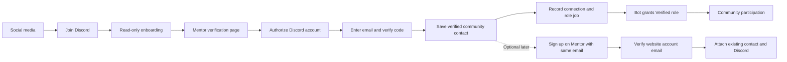

# Discord community verification — proposed design

Status: local MVP and test-server E2E passed; shared-channel private responses added to the plan on 6 October 2026. Community verification creates a contact, not a website account. Later signup using the same verified email can claim the contact. The test server is `1556786037307613317`; the real server has only its empty Verified role prepared so far. See [the setup guide](./discord-test-setup.md) and [MVP runbook](./discord-verification-mvp.md) for recorded tests and remaining launch work. No PR or production deployment is authorized yet.

## Confirmed entrypoint: shared channel, private responses

Use one read-only `#verify-first` channel with a permanent bot message: **Verify your email**, **Start verification**, and **Check status**. Everyone can access the message. New arrivals generate no public message or mention. Check existing system welcome messages and other bots independently during the pilot.

Clicking Start verification produces a private Discord response with a website button. The opaque, expiring link is bound to the Discord member who clicked; OAuth must prove that same identity. Email and codes are entered only on the website. No website account is created.

Check status always creates a fresh private response. Statuses are Waiting for verification, Accept the server rules, Activating community access, Activation delayed, Activation needs attention, and Verification complete. Completion requires the actual Verified role; an email proof or a queued role job alone is insufficient. Existing members with granted access also see access confirmed without having to link an email.

Only the latest private response per member receives automatic updates. Discord interaction tokens last 15 minutes; stop attempts after 14 minutes for a safety margin. After expiry or dismissal, clicking either permanent button starts a fresh reply. Keep the channel readable after granting Verified so the member can return and check status.

A successful private reply shows only the access confirmation and Check status. Remove the Verify email button when an existing waiting reply becomes successful. Never show Link your email in a successful reply.

Implement HTTP interactions with raw-body Ed25519 signature verification, fresh timestamps, application/guild/channel checks, retry deduplication and a per-member click limit. Defer privately before database/provider work to meet Discord's three-second response deadline. Store interaction tokens encrypted in short-lived, environment-separated Mongo collections. Notification failures do not affect role/list activation and never fall back to public messages. Website completion and the existing recovery processor retry private updates within their hosting budget.

Test this entirely in the existing test server first: permanent buttons, private waiting response, matching OAuth identity, rejected different identity, successful code/role grant and automatic private success, delayed activation/recovery, repeated clicks, fresh status after expiry, suppression of mentions, and no public status posts. The real-server pilot follows only after owner review.

Platform references: [Discord interactions and expiry](https://docs.discord.com/developers/interactions/receiving-and-responding), [request signature verification](https://docs.discord.com/developers/interactions/overview), [mention suppression](https://docs.discord.com/developers/resources/message#allowed-mentions-object).

## Purpose and recommendation

Make Discord the first destination from social media. New arrivals can read onboarding instructions but cannot participate until they prove control of both a Discord account and an email address on the Mentor site. The backend then assigns a `Verified` role.

Confirmed identity model: create a community contact with a verified email and Discord connection, without creating a Mentor account or granting website access. They can join the email list first. If they later create and verify a Mentor account using the same email, attach the existing community contact and Discord connection to that account. The profile then becomes the place to manage the connection.

Email verification adds friction to abuse; it does not prove a real-world identity or prevent someone using multiple email addresses. Discord moderation, AutoMod, screening, and channel permissions remain necessary.

## Findings in this repository

| Existing component | Design implication |
| --- | --- |
| `src/lib/auth.ts`: Better Auth with MongoDB, password signup, Google, email verification links | Keep existing signup/login. Community email verification must work independently without registering an auth user. |
| `src/lib/email.ts`: shared Resend sender | The helper now checks returned errors and rejects missing production configuration. The community adapter uses the same Resend sending key/sender with bounded requests and no code logging. |
| `src/app/mentor/account/page.tsx` and `src/Components/AccountForm.tsx` | Add connection status, link, unlink, and replace controls here. |
| `src/lib/session.ts`: membership means a signed-in, email-verified user | A community contact must not satisfy this gate. Discord verification grants no Blueprint course or TJSS dashboard access. |
| `src/lib/ratelimit.ts`: MongoDB counters | Reuse the shared-storage approach. Verification endpoints must reject or pause on limiter failure rather than use the current fail-open policy. |
| `src/lib/analytics.ts`: users count as members | Track community acquisition separately from actual course activation, otherwise signup growth will distort course conversion metrics. |
| `src/middleware.ts`: Mentor subdomain rewrites page paths; API paths remain `/api/*` | Public verification page belongs under `src/app/mentor`; callback and service routes belong under `/api`. |
| `src/lib/disclosure-config.ts`: current privacy copy covers email/accounts, not Discord | Add clear explanation of Discord ID storage, account linking, and email preferences. |

The installed Better Auth OTP sign-in creates accounts for unknown emails by default; disabling signup does not provide verification for unknown community contacts. Do not use that sign-in path for community verification. Use a dedicated community challenge with secure code storage, expiry, atomic consumption, and attempt limits, while reusing the existing Resend helper. Keep Better Auth as the authority for website signup and account email verification. See [Better Auth email OTP behavior](https://better-auth.com/docs/plugins/email-otp).

The local Next.js route-handler and `after` guides were reviewed. Background callbacks have a bounded invocation lifetime; they are not a durable retry queue.

## Member workflow

1. Social post sends the member to the Discord invite. Use campaign-specific invites where useful; a shared verification link alone cannot reliably attribute which social post caused the join.
2. Member joins and sees read-only `#welcome`, `#rules`, and `#verify`. The verification message links to `https://mentor.thomas-johnston.com/discord/verify`.
3. Page explains the process and opens Discord authorization. Start with the `identify` scope only. The server exchanges the authorization code, fetches the immutable Discord user ID, and checks that this account is in the configured community.
4. Show the selected Discord identity, with a way to switch accounts. Never ask for a typed Discord username/ID as proof.
5. Member supplies an email. Clearly state that verification joins the community email list, with no optional opt-in checkbox. Record the enrollment notice version and acceptance time. A short code is sent through Resend; it identifies the community and selected Discord connection being approved.
6. Member enters the code. The backend atomically consumes the challenge bound to this flow, email, and Discord identity, checks uniqueness and community eligibility, and records the verified contact, connection, and desired role update durably. No Better Auth account or website login session is created.
7. Backend tries the role update immediately. Show success only after Discord confirms it; otherwise show “Email verified — Discord access is being activated” with a status/retry control. Retrying must not require another email code while the scoped verified flow remains valid.
8. Success offers “Return to Discord” as the primary action and optional website signup as a next step. Add the confirmed contact to Resend's `Discord Community` segment after verification; mailing-provider failure must not block community access. Resend now calls Audiences Segments. Preserve an existing contact's unsubscribe state rather than automatically resubscribing them during a retry or reverification.

Existing website users can sign in with the existing password/Google options and link Discord. A recent authenticated session and verified account email can establish email ownership; require fresh authentication for an old session or sensitive changes. Anonymous community visitors still use the community code flow, even if that email already has a website account.

Discord OAuth establishes ownership of Discord independently from email. Do not request Discord's `email` scope, import that email, or automatically merge Mentor accounts through Discord social login. See [Discord OAuth scopes and state validation](https://docs.discord.com/developers/topics/oauth2).

## Discord configuration

- `@everyone`: access to onboarding only; deny participation in community text, threads, forums, reactions, and voice. Configure private categories for verified users and test channel overrides and all other auto-assigned roles.
- `Verified`: grants intended community access without moderation privileges.
- Verification bot: server-installed, with `Manage Roles`; its role must be above `Verified`. Place staff roles above the bot and do not grant Administrator.
- Remove competing auto-role/reaction-role paths that grant participation without verification.
- If Rules Screening is enabled, do not grant `Verified` while the member is `pending`. Ask them to finish screening in Discord and retry. Test this combination on the real server; Discord documents specific interactions between screening and third-party role gates.
- Keep AutoMod, anti-spam settings, and a moderator reporting route. Website verification cannot prevent all unsolicited DMs or malicious behavior by verified members.

Role assignment/removal uses the bot's authenticated Discord REST API. A continuously connected Gateway bot is not needed for this MVP. Immediate rejoin handling or join-event automation can be added later with a Gateway worker. See [Discord role permissions](https://docs.discord.com/developers/topics/permissions), [guild role and membership APIs](https://docs.discord.com/developers/resources/guild), and [Rules Screening](https://support.discord.com/hc/en-us/articles/1500000466882-Rules-Screening-FAQ).

## Components and data

Use the existing Next.js backend, Better Auth, MongoDB, and Resend. Add a Discord REST adapter and a durable MongoDB job/outbox with a protected scheduled processor. Confirm the actual deployment plan and supported scheduler cadence before selecting the processor; durable recovery is part of launch scope, not a later enhancement.

| Record | Purpose and constraints |
| --- | --- |
| Better Auth user/session/verification | Own website identity and verified-email proof only when someone chooses to sign up. Use supported auth APIs rather than writing auth records directly. |
| `communityContacts` | Stable contact ID, email normalized consistently with Better Auth, email-verification time, acquisition source, moderation status, and optional claimed Mentor user ID. Unique email and unique claimed user ID where present. Do not strip dots or plus aliases to merge distinct addresses. |
| `discordVerificationFlows` | Short-lived flow ID, browser binding, one-time OAuth state, resolved Discord ID, intended email, expiry, keyed code hash, atomic attempt count/consumption, progress, and completion reference. Bind the code to this exact operation. Reject expired state explicitly; TTL deletion is only cleanup. |
| `discordConnections` | Community contact ID, Discord user ID as a string, display-name snapshot, verification timestamps, active/revoked status, role-operation generation, and moderation eligibility. Unique active contact ID and Discord ID; one active connection per verified email/contact and Discord identity. |
| `discordRoleJobs` | Guild, Discord ID, role, grant/remove action, connection generation, attempts, next attempt, lease, state, and redacted failure details. Deduplicate repeated operations. |
| `emailPreferences` | Community-list enrollment, source, acceptance time, notice version, unsubscribe history, Resend contact/segment IDs, and provider sync state. Link to community contact ID so enrollment history survives later website signup. |
| Existing events plus security audit records | Funnel milestones and connection/role changes. Keep secrets, email codes, and unnecessary email addresses out of analytics. Security audit writes must not depend on the existing best-effort analytics helper. |

Persist the connection transition and job atomically using MongoDB transactions if available, or a single-document embedded outbox with a recoverable processor. An independent “write connection, then enqueue” sequence can lose work on a crash.

Proposed interfaces, subject to implementation detail:

- `POST /api/discord/connect/start`: create a flow and return the Discord authorization URL.
- `GET /api/discord/connect/callback`: validate state, resolve Discord identity, then redirect to the confirmation page. Callback must not assign a role.
- `POST /api/discord/verification/send-code`: validates the pending Discord flow and send limits, then sends a community email challenge.
- `POST /api/discord/verification/confirm`: verifies and consumes the flow-bound code, then records contact/connection and desired access once.
- `GET /api/discord/connect/status`: authenticated website session or securely bound community flow status; never publicly exposes connection data.
- `POST /api/discord/disconnect`: fresh website authentication or a short-lived community management session, marks revocation and queues removal.
- Protected scheduled processing endpoint: lease and retry due jobs. Not publicly executable without authentication.

## Linking, unlinking, and account recovery

- Before website signup, a “Manage community connection” page uses a fresh email code to issue a limited management session for the contact. This session has no website membership privileges and may manage only that contact's connection. Codes explicitly identify management authorization and cannot be reused as connection/signup proofs.
- After website signup, the profile shows the Discord identity and actual access status, including pending removal or a failed update.
- Unlink removes `Verified`, preserves the community contact and any Mentor account, and does not change newsletter consent.
- Replace requires recent authentication and fresh OAuth for the new Discord identity. Lock/reserve the transition; remove access from the old identity before granting the new one. If removal fails, keep replacement pending. Do not grant both accounts access.
- If the old account has left the guild, absence can satisfy removal. Preserve a revoked connection record so it cannot be automatically restored on a future rejoin.
- A Discord account already attached elsewhere cannot be stolen by supplying its ID or matching an unverified email. Show a generic conflict and provide recovery through verified email/authentication/support; do not reveal the other contact's email.
- Later account signup claims the contact only after server-side confirmation that the account email is verified and matches the contact email. Use an idempotent claim on verified authentication/account-verification completion, with an authenticated reconciliation fallback. Typing the same email on an unverified signup does not claim anything. Preserve the contact ID, preferences, moderation history, and Discord connection; reject conflicting existing claims for support review.
- A previously unverified website account must be recovered through Better Auth's supported verified-email path, including invalidating unproven credentials/sessions; do not merely flip `emailVerified` manually. Community verification must not promote such a website account.
- For MVP, rejoining members revisit the verification page, reauthorize Discord, and prove email ownership again unless they have a valid scoped management session or a recently authenticated claimed website account. Automatic role restoration is a later decision.
- Contact email changes before signup require proof of both current and new email. After claiming, website email changes must also update the contact through an explicit verified transition with conflict checks; avoid silently diverging identities or subscription preferences. Suspend new grants while a claimed email change is unverified.
- Deleting a website account and deleting the community contact are distinct requests. Clarify scope; full contact deletion revokes Discord access and subscriptions, with the removal job surviving long enough to finish.
- Community blocks apply to the contact, any claimed Mentor identity, and known Discord identities, so changing the connection does not erase a recorded moderation restriction. New unrelated emails/accounts remain a limitation of this model.

## Abuse controls and reliability

Proposed starting settings: six-digit single-use codes, five-minute expiry, three wrong attempts per code, at least 60 seconds between sends, and additional rolling limits per email, Discord ID, IP, and globally. Code resend must not reset an unlimited total guess budget. Tune limits against actual traffic; do not impose a low IP-only limit that blocks shared networks.

Store short numeric codes using a server-secret keyed hash over the flow, purpose, email, Discord ID, and code. Use constant-time comparison and atomic attempt increments/consumption. Never store or log plaintext codes. Add a server-validated bot challenge when traffic/risk warrants it and reserve provider capacity for password/account recovery. Community proof sessions remain separate from Better Auth sessions.

OAuth state is random, short-lived, single-use, and bound to the initiating browser/session. Only allow known redirect targets. Keep bot/client secrets server-side. No lasting user OAuth token storage is needed for identify-only verification; discard tokens after identity resolution. Use a separate staging bot/guild/database so previews cannot grant production roles.

Workers use leases and per-connection serialization. Before each attempt, confirm that the desired operation still matches the active connection generation and moderation eligibility. Coordinate replacement with in-flight grants, and compensate stale operations so delayed work cannot restore revoked access.

- Discord 429: respect rate-limit headers and retry timing; add jitter.
- Discord 5xx/network timeout: retry durably; handle unknown outcomes idempotently.
- Permission/token/role errors: stop blind retries, show pending/failure accurately, and flag operator attention.
- Member absent: ask them to join the configured server; no autojoin or `guilds.join` scope in MVP.
- Database or verification-control outage: deny new grants/sends rather than bypass verification.
- Email-provider rejection/quota: show send failure, preserve retry state, and never claim a code was sent successfully.

Routine reconciliation should finish recorded operations, not automatically re-grant every missing role: a moderator may have intentionally removed access. Provide a site admin revoke/block control and define how Discord-only moderation actions are reflected before introducing automatic restoration.

## Email capacity and measurement

Resend currently advertises Free at 3,000 transactional emails/month with a 100/day cap; Pro starts at US$20/month for 50,000, without the daily cap. These are public prices checked on 6 October 2026, not a confirmation of the owner's subscription. See [Resend pricing](https://resend.com/pricing).

Budget new verifications + resends + website verification/reset messages. For example, 200 new verifications/day with 20% resend overhead is about 7,200 messages/month before existing account traffic. The free daily limit can interrupt a launch spike well before the monthly allowance runs out. Confirm sender-domain verification and delivery in the actual account before launch. Transactional quota is separate from marketing/contact-plan decisions.

Confirmed: verified contacts join the community list in Resend as part of entry, before choosing to make website accounts; there is no optional opt-in checkbox. Suggested notice: “By verifying, you join the community and Thomas Johnston's email list for community updates and occasional educational content. You can unsubscribe from emails at any time. This does not create a Mentor account.” The submit button can say “Send verification code”; the notice must be visible beside it. Record acceptance and complete enrollment only after email ownership is proved.

Use Resend's global Contacts and a `Discord Community` segment; its legacy Audiences API is deprecated. Use a separate `Discord Community - Test` segment and controlled test email addresses for the pilot. Resend global unsubscribe state spans segments, so testing unsubscribe must use a dedicated test contact. Creating the list does not send a Broadcast. See [Resend's current Contacts model](https://resend.com/blog/new-contacts-experience) and [Segments setup](https://resend.com/docs/dashboard/contacts/manage-segments).

Respect subsequent unsubscribe and suppression status. Never reset `unsubscribed` to false on an existing contact merely because they verify again. Unsubscribing from newsletters preserves community verification and website access. Resend owns current Broadcast subscription status; MongoDB owns community identity and keeps enrollment history plus synchronization status. Use a retry job to recover failed list sync without duplicating contacts. Before launch, check the account's marketing contact allowance independently from transactional limits. Resend documents Free as 100 transactional emails/day, 3,000/month, and marketing emails to up to 1,000 contacts. See [Resend account quotas](https://resend.com/docs/knowledge-base/account-quotas-and-limits).

Measure: verification page opened, Discord authorized, code send accepted, code verified, role confirmed, abandoned stage, and later course activation. Monitor send failures, quota pressure, retry backlog age, role permission failures, and verification completion time. Provider acceptance is distinct from inbox delivery.

## Delivery and acceptance plan

1. Set up the Resend community/test segments, enrollment notice, bot/test guild, and development credentials. Confirm expected traffic and migration of existing members. Account creation is explicitly excluded from community verification. Review actual Discord roles, bots, screening, sender setup, and hosting scheduler.
2. Build verification and durable role assignment in a staging guild; keep profile connection management in the same initial release so people have a recovery path.
3. Test contact creation without any auth user/session or site access; later signup and claim after email verification; unverified signup cannot claim; repeated/concurrent claims; conflicting emails; existing website users; expired/wrong/replayed codes; cross-browser flow mismatch; OAuth denial and wrong Discord account; duplicate links; shared-IP limits; public endpoint abuse; database/provider outages; permission errors; role retry after timeout; removal/replacement races; rejoin; moderation blocks; unsubscribe persistence; and production access bypass protection.
4. Test a genuinely unverified Discord member across text, threads, forums, reactions, voice, and other assigned roles. Verify screening completion and actual role hierarchy.
5. Pilot with a small group, then enable for new joins. If existing members must verify, use an announced grace period and staged migration. Do not remove all existing access in one untested operation.
6. Rollback stops new mutations and directs users to a clear paused-verification notice while operators recover. Do not unlock `@everyone` as a failure workaround.

## Decisions still needed

1. Confirmed: save a community contact first; no automatic Mentor account. Later verified signup with the same email claims the existing contact and connection.
2. Confirmed: Resend holds the list and enrollment is part of verification; no optional checkbox. Make enrollment visible and preserve later unsubscribe status. The 100/day cap is acceptable for MVP testing.
3. Still needed: existing-member verification policy and actual expected pilot traffic; verify current Resend marketing/contact allowance.
4. Confirmed test setup: the user created the separate server (`1556786037307613317`), and the approved inbox is configured locally. Still needed: new bot/application/role credentials, test invite, Resend contact-management key/test segment, verified sender, actual channel/auto-role checks, and deployment scheduler support. A local read-only Segments request on 6 October returned HTTP 401 with `restricted_api_key`: “This API key is restricted to only send emails.” Keep the existing sending key; use a separate contact-management key. This result does not indicate broken email sending. Deployed credentials may differ.
